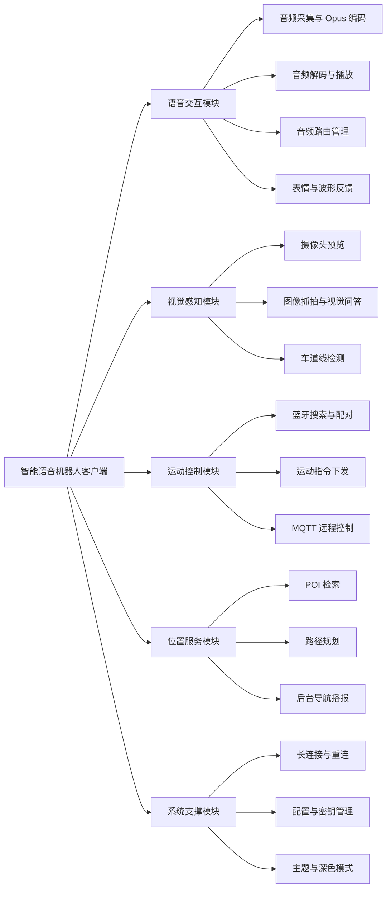
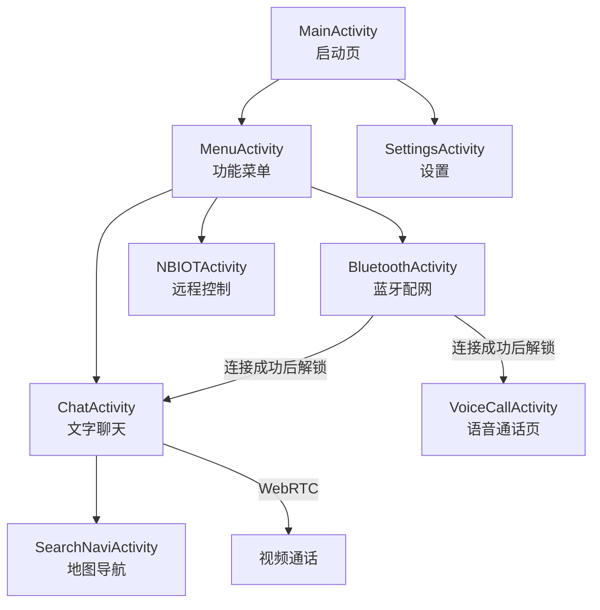
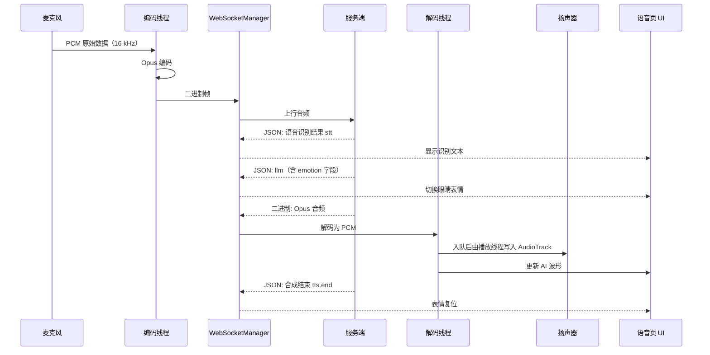
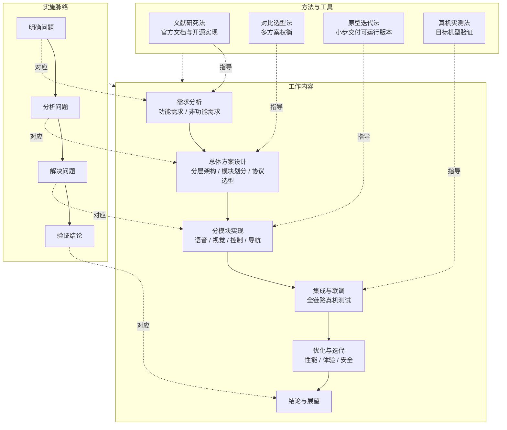

# 基于 Android 的智能语音交互机器人客户端系统设计及实施方案

---

## 1 题目

**基于 Android 的智能语音交互机器人客户端系统设计与实现**

### 1.1 选题背景

随着大语言模型与嵌入式设备的结合日益紧密，以"语音对话 + 实体动作"为交互形态的智能机器人逐渐进入家庭与教学场景。此类系统通常由两部分组成：负责拾音、运算与决策的**云端/服务端**，以及负责呈现与操控的**移动客户端**。前者已有较成熟的实现，而后者长期存在三个痛点：语音链路的时延与抖动难以控制、多路传感器（麦克风/摄像头/蓝牙/定位）之间的资源竞争、以及交互反馈生硬。

本课题以"小智"智能语音机器人为对象，设计并实现其 **Android 端客户端**，解决上述三个问题。

### 1.2 系统定位

本客户端是智能语音机器人的**移动端上位机**，承担四类职责：

| 职责 | 说明 |
|---|---|
| **语音交互** | 采集用户语音上传，接收并播放服务端合成的语音回复 |
| **远程控制** | 通过蓝牙串口驱动小车运动；通过 NB-IoT/MQTT 实现广域远程控制 |
| **视觉感知** | 摄像头预览、图像抓拍，配合服务端视觉大模型完成"看图回答" |
| **位置服务** | 地图检索、路径规划与后台导航播报 |

### 1.3 开发环境与技术栈

| 项目 | 选型 |
|---|---|
| 开发语言 | Java（少量 Kotlin，Opus 编解码示例） |
| 开发工具 | Android Studio |
| 最低版本 | Android 10（API 29） |
| 目标版本 | Android 15（API 35） |
| 构建工具 | Gradle + CMake（NDK 侧编译 Opus/OpenCV） |
| 实时通信 | Java-WebSocket 1.5.4、WebRTC 104.5112.09、Eclipse Paho MQTT 1.2.0 |
| 音频编解码 | Opus（16 kHz / 单声道 / 60 ms 帧） |
| 视觉 | CameraX、Camera2、OpenCV 4.5.0 |
| 地图 | 腾讯地图矢量 SDK 4.5.5.1 + 导航 SDK 5.3.8.3 |
| 本地存储 | MMKV、SharedPreferences |

---

## 2 系统分析

### 2.1 可行性研究

#### 2.1.1 技术可行性

- **语音链路**：服务端采用 Opus 编码，客户端已有对应的 JNI 编解码库；WebSocket 提供全双工通道，二进制帧可直接承载 Opus 数据，无需额外的信令协议设计。
- **实时音视频**：WebRTC 官方 Android SDK 提供完整的回声消除、抖动缓冲与拥塞控制，避免自研。
- **视觉**：CameraX 统一了 Camera2 的设备差异；OpenCV 4.5.0 以本地模块形式集成，可直接使用其 Haar/LBP 级联分类器与图像处理算子。
- **地图导航**：腾讯地图 SDK 提供 POI 检索、路径规划与导航播报的完整闭环，且提供免费额度。
- **结论**：所需技术均有成熟方案，无需从零实现底层算法，**技术上可行**。

#### 2.1.2 经济可行性

全部依赖均为开源项目或提供免费开发额度（腾讯地图、WebRTC、OpenCV、Opus），开发阶段**无软件授权费用**；调试使用已有的 Android 手机与自制的智能小车硬件，无额外采购成本。**经济上可行**。

#### 2.1.3 操作可行性

最终形态为一部手机上的 App，用户通过桌面图标启动，无需专门的遥控器或 PC 端。蓝牙配对、摄像头授权、位置授权均复用 Android 系统标准流程，符合用户既有的使用习惯。**操作上可行**。

### 2.2 需求分析

#### 2.2.1 功能性需求

| 编号 | 需求名称 | 具体描述 |
|---|---|---|
| FR-1 | **语音对话** | 按下即说，客户端采集语音编码上传；服务端返回文本与合成语音，客户端实时播放并展示识别/回复文本 |
| FR-2 | **表情反馈** | 机器人脸部以"眼睛"的形式呈现当前情绪，情绪由服务端下发的 `emotion` 字段驱动 |
| FR-3 | **视频通话** | 基于 WebRTC 的点对点音视频通话，支持本地摄像头预览开关 |
| FR-4 | **视觉识别** | 通过 MCP 协议向服务端视觉大模型发起"抓拍并回答"，例如"画面里有什么" |
| FR-5 | **蓝牙控制** | 搜索并连接小车蓝牙，连接成功后向小车发送运动指令；未连接时限制相关入口 |
| FR-6 | **远程控制** | 通过 MQTT（NB-IoT 网络）远程下发控制指令，并回传小车状态 |
| FR-7 | **地图导航** | POI 关键字检索，选择目的地后启动导航，支持后台持续播报 |
| FR-8 | **图像检测** | 后置摄像头实时检测车道线，输出偏移距离与行驶建议 |
| FR-9 | **设置管理** | 服务地址、令牌、昵称等参数的配置与持久化 |

#### 2.2.2 非功能性需求

| 类别 | 指标 |
|---|---|
| **实时性** | 语音端到端往返延迟控制在可对话的范围内；音频播放不出现断续 |
| **流畅性** | 语音页在同时进行音频解码、播放、波形绘制与摄像头预览时不掉帧 |
| **可靠性** | WebSocket 断线自动重连；蓝牙断开后可重新连接；音频队列满时丢弃旧帧而非阻塞 |
| **兼容性** | 支持 Android 10 ~ 15；适配深色模式；适配蓝牙耳机等外接音频设备 |
| **安全性** | 密钥不得硬编码于源码或提交进版本库 |
| **可维护性** | 颜色、文案、密钥等资源集中管理；模块职责清晰 |

---

## 3 系统总体设计

### 3.1 系统层次结构

系统采用**五层结构**，自顶向下依次为表现层、业务逻辑层、服务层、通信协议层与基础设施层。上层依赖下层，同层之间通过明确接口交互。

```mermaid
graph TB
    subgraph L1["表现层（UI）"]
        direction LR
        A1[启动页<br/>MainActivity]
        A2[功能菜单<br/>MenuActivity]
        A3[语音通话页<br/>VoiceCallActivity]
        A4[文字聊天页<br/>ChatActivity]
        A5[蓝牙配网页<br/>BluetoothActivity]
        A6[地图导航页<br/>SearchNaviActivity]
        A7[远程控制页<br/>NBIOTActivity]
        A8[设置页<br/>SettingsActivity]
    end

    subgraph L1C["自定义控件"]
        direction LR
        C1[EyeView<br/>表情眼睛]
        C2[WaveformView<br/>音频波形]
    end

    subgraph L2["业务逻辑层"]
        direction LR
        B1[WebSocketManager<br/>长连接与消息分发]
        B2[WebRTCManager<br/>音视频通话]
        B3[AudioRouteManager<br/>音频路由]
        B4[NavigationServiceManager<br/>导航状态]
        B5[DataManager<br/>检测结果共享]
        B6[SettingsManager<br/>配置持久化]
    end

    subgraph L3["服务层（Service）"]
        direction LR
        S1[BluetoothService<br/>蓝牙串口]
        S2[CameraDetectionService<br/>车道线检测]
        S3[NavigationBackgroundService<br/>后台导航]
    end

    subgraph L4["通信协议层"]
        direction LR
        P1[WebSocket<br/>JSON + Opus 二进制]
        P2[WebRTC<br/>音视频流]
        P3[MQTT<br/>远程控制]
        P4[蓝牙 SPP<br/>小车指令]
        P5[MCP<br/>视觉工具调用]
    end

    subgraph L5["基础设施层"]
        direction LR
        I1[OpusJNI<br/>编解码]
        I2[CameraX / Camera2]
        I3[OpenCV 4.5.0]
        I4[腾讯地图 SDK]
        I5[MMKV / SharedPreferences]
    end

    L1 --> L2
    L1C -.被引用.-> L1
    L2 --> L3
    L2 --> L4
    L3 --> L4
    L4 --> L5
```

### 3.2 功能模块划分

### 3.3 页面导航结构

> 说明：`BluetoothActivity` 中的"进入小车系统 / 进入远程控制"两个入口在**蓝牙未连接时置为禁用态**，从交互层保证后续页面的指令下发一定有效。

### 3.4 关键数据流——一次语音对话的完整往返

---

## 4 技术路线

### 4.1 技术路线图

技术路线按"**需求驱动 → 方案设计 → 分模块实现 → 集成联调 → 优化迭代**"的主线推进，每一阶段均以可运行的真机版本作为交付物。

### 4.2 各阶段工作说明

| 阶段 | 主要工作 | 交付物 | 采用方法 |
|---|---|---|---|
| **一、需求分析** | 梳理机器人的交互场景，拆解为可量化的功能与非功能需求 | 需求清单（FR/NFR） | 文献研究法、实地观察 |
| **二、方案设计** | 确定五层架构；选定 WebSocket + Opus 作为语音链路、WebRTC 作为视频链路、MQTT 作为远程链路 | 架构图、模块图、接口约定 | 对比选型法 |
| **三、模块实现** | 按语音、视觉、控制、位置四条主线并行开发，每条线独立可测 | 可运行的单模块版本 | 原型迭代法 |
| **四、集成联调** | 打通"手机—服务端—小车"全链路，解决资源竞争与线程冲突 | 完整功能的测试版本 | 真机实测法 |
| **五、优化迭代** | 针对时延、流畅度、深色模式、密钥安全等问题逐项整改 | 优化后的发布候选版本 | 真机实测法、对比实验法 |

---

## 5 开发过程中遇到的关键技术及解决方法

### 5.1 实时语音链路：编解码与播放队列

**问题**：语音对话要求"边说边传、边收边放"，但网络抖动会导致音频帧到达间隔不均匀，直接写入 `AudioTrack` 会造成断续和爆音。

**解决**：

1. 采用 **Opus 编码**（16 kHz 单声道、60 ms 帧），在保证语音质量的前提下把码率压到很低，降低带宽压力。
2. 引入**有界阻塞队列**作为播放缓冲：解码线程只负责把 PCM 投入队列，播放线程从队列中取出并写入 `AudioTrack`。两个线程通过队列解耦，网络抖动不会直接传导到音频硬件。
3. 队列设上限，**满时不阻塞而是丢弃最旧帧**。语音交互中"实时"优先于"完整"，丢弃旧帧比让用户听到延迟累积的音频更可接受。
4. 设置**预缓冲阈值**：队列积累到一定帧数后才启动播放，避免开头几个字因队列未填满而被拉长。

**效果**：语音播放连续，无明显断续；打断（用户插话）时清空队列即可立即停止当前回复。

---

### 5.2 线程模型：四路音频线程的职责隔离

**问题**：语音页同时存在"采集—编码—发送"与"接收—解码—播放"两条流水线，若共用线程或直接在主线程处理，会出现采集被解码阻塞、UI 被音频处理阻塞等问题。

**解决**：为每一段流水线分配**独立的单线程线程池**，互不干扰：

| 线程池 | 职责 |
|---|---|
| `executorService` | 从麦克风读取 PCM |
| `audioEncoderExecutor` | 取 PCM → Opus 编码 → 发送 |
| `audioExecutor` | 接收 Opus → 解码为 PCM |
| `playbackExecutor` | 从队列取 PCM → 写入 AudioTrack |
| `cameraExecutor` | 摄像头帧分析与缓存 |

线程之间**只通过线程安全的队列传递数据**，不共享可变状态。涉及 UI 的更新一律通过主线程 Handler 投递。

**效果**：单条流水线的卡顿不会传导到其他流水线，语音与摄像头预览可以长时间并行运行。

---

### 5.3 蓝牙耳机下的音频路由失效

**问题**：连接蓝牙耳机后，系统已显示"已连接"，但通话音频仍从手机扬声器播出，且扬声器/听筒切换按钮无效。

**分析**：蓝牙存在两条互斥的音频通路——**A2DP**（媒体播放，单向、高音质）与 **SCO/HFP**（双向通话，低带宽）。系统默认把音频走 A2DP，而语音通话属于双向通信，必须显式请求 SCO 通道。仅设置 `MODE_IN_COMMUNICATION` 并不足以让系统自动切换。

**解决**：

1. 编写 `AudioRouteManager` 统一管理音频路由，在进入通话时：
   - 切换到 `MODE_IN_COMMUNICATION`；
   - 关闭扬声器外放；
   - 若检测到蓝牙耳机已连接，**显式调用 `startBluetoothSco()` 并置 `setBluetoothScoOn(true)`**，请求 SCO 通道。
2. 监听 `ACTION_SCO_AUDIO_STATE_UPDATED` 广播，SCO 建立存在**异步握手过程**，需要等待状态回调；设置失败重试上限，避免无限重试。
3. 同时监听蓝牙连接状态变化，耳机在通话中途接入或断开时能够重新选路。
4. 对 Android 12 及以上，改用新的 `setCommunicationDevice()` 接口，旧接口做兼容分支。

**效果**：蓝牙耳机接入后音频正确从耳机输出，扬声器切换按钮在蓝牙场景下被正确忽略（避免误把通话切到外放）。

---

### 5.4 波形绘制导致的界面卡顿

**问题**：AI 说话时界面明显掉帧，波形区域尤其严重。

**分析**：定位后发现两个原因叠加——

1. **未降频**：人声波形做了 50 ms 的刷新节流，AI 波形却是**每一个音频帧都投递一次主线程重绘**。
2. **点数远超分辨率**：一帧 PCM 有 1440 个采样点，`onDraw` 里把它们全部拼成一条 1440 段的路径并做抗锯齿描边。而波形视图宽度约 800 px，**相邻两点间距不足 1 像素**，绝大多数线段挤在同一像素列里；路径内容每帧都变，渲染引擎就必须每帧重新三角化整条路径。

此外还有一个隐藏缺陷：采样缓冲区是复用的，长度恒为 1440，当某帧实际只有部分采样有效时，**尾部残留的是上一帧的数据**，既画错又多算了开销。

**解决**：

1. **降频**：AI 波形与人声波形统一为 50 ms 刷新一次，与人眼对这类动态提示的分辨能力匹配。
2. **降采样**：把 1440 点压缩到 100 点后再交给视图。采用**峰值包络**（每个区间取绝对值最大的采样并保留符号）而非"每隔 N 个取一个"，避免尖峰被整段跳过导致波形跳动。
3. **前置到子线程**：降频与降采样都在音频解码线程完成，主线程只接收一个 100 点的小数组。
4. **双缓冲**：降采样结果需要投递到主线程绘制，单个缓冲区会在主线程尚未绘制完成时被下一帧覆盖，造成波形随机跳变，改用两个缓冲区轮换。
5. **传递有效长度**：视图接口增加"有效点数"参数，不再按数组长度绘制。

**效果**：主线程每帧的路径从 1440 段降至 100 段，绘制开销约降至原来的 7%，同时消除了残留数据导致的画面错误。

---

### 5.5 深色模式下的可读性问题

**问题**：切换到深色模式后，页面顶部的文字与背景同为黑色，完全无法辨认。

**分析**：布局中大量直接写死了 `@color/white` 与 `@color/black`。深色模式下系统属性 `windowBackground` 变为深色，而文字色仍是硬编码的黑色，二者叠加导致不可读。

**解决**：

1. **建立语义色体系**：将颜色按用途抽象为 `text_primary`、`surface`、`surface_alt`、`divider` 等语义名，日间值与夜间值分别在 `values/colors.xml` 与 `values-night/colors.xml` 中维护，布局一律引用语义色。
2. **区分"中性色"与"品牌色"**：品牌色在深浅底色上均有足够对比度，无需两套；只有中性色需要按模式覆盖。
3. **非颜色属性抽成布尔资源**：状态栏图标明暗这类配置无法通过颜色覆盖实现，且样式资源是**按配置整体替换而非逐项合并**，直接复制一份夜间主题极易漏项。改抽为 `@bool` 资源后，只维护一份主题定义。
4. **谨慎处理"刻意深色"的页面**：语音通话页本身就是黑底白字的深色设计（配合视频画面），若在色板层面全局反转黑白，会把该页面意外反转。因此不对 `white`/`black` 做全局覆盖，而是按上下文替换为语义色。

**效果**：深色模式下所有页面文字清晰可读，且语音页的深色设计未被破坏。

---

### 5.6 摄像头预览关闭后的画面残留

**问题**：点击关闭摄像头后，预览区域仍停留在最后一帧画面上。

**分析**：定位到状态变量被**重复翻转**——开关函数内部在启动/停止时各翻转一次状态，函数体末尾又翻转了一次。结果是关闭时出现"摄像头已解绑、但预览视图仍被设为可见"的状态。而预览控件底层基于 SurfaceView，解绑只是停止出帧，最后一帧仍保留在其图层中，无人清除，于是画面残留，并且该状态无法自行恢复。

**解决**：

1. **收敛状态源**：状态变量只由启动/停止函数维护，调用方不再重复翻转。
2. **显式清除**：停止时按"先解绑、再隐藏视图"的顺序处理，视图不可见后其 Surface 被销毁，残留画面随之消失。
3. **异常路径同样收尾**：相机服务获取失败、绑定失败等分支统一走停止流程，避免留下一个空白预览框。

---

### 5.7 表情眼睛的连续形变

**问题**：机器人需要一对能够表达情绪的眼睛，且情绪之间要平滑过渡，而不是瞬间跳变。

**分析**：最初的实现用圆角矩形绘制眼型，但"开心"需要的是向上弯曲的月牙形，与圆角矩形属于不同的拓扑结构，无法通过参数连续过渡；若改用两种图元交叉淡入淡出，过渡中间会出现重影。

**解决**：

1. **改用贝塞尔轮廓**：眼型重写为"上眼睑一条三次贝塞尔 + 下眼睑一条三次贝塞尔"围成的闭合轮廓。关键在于让两条曲线在眼角处的切线均指向竖直方向，使轮廓在每个眼角平滑过渡、不出现尖角，两端自然收成一个带尖的眼角。
2. **参数化表达**：该轮廓由"眼睑开合度、宽高缩放、弯曲量、倾斜角、垂直偏移"五个连续参数完全决定。**月牙眼不再是另一套画法，而只是"高度压扁 + 两端下沉"的同一个轮廓**，因而所有情绪都可以连续插值，无需图元切换。
3. **情绪驱动**：服务端在消息中下发结构化的 `emotion` 字段。客户端将其枚举名与本地情绪枚举**保持同名**，直接做名称映射，不维护第二张对照表，从根上消除了"两边表格对不上"这类问题；对无法识别的取值一律回落到中性情绪，保证不会崩溃。
4. **过渡曲线**：采用指数逼近而非线性插值，帧率波动时表现一致，且不会出现回弹过冲。
5. **眨眼与情绪正交**：眨眼是独立的高频动作，与情绪的"开合度"相乘而非覆盖，因此眯眼状态下依然能正常眨眼。
6. **规避软件层渲染**：辉光效果通过"叠加两层放大的同一形状"实现，而非使用模糊遮罩或阴影图层——后两者会强制视图切换到软件渲染，代价高得多。

---

### 5.8 密钥硬编码与泄露风险

**问题**：地图、语音识别等第三方服务的密钥以字符串常量形式直接写在源码与资源文件中，随代码一并提交进了版本库。**一旦密钥进入版本库历史，无论仓库是否公开都应视为已泄露。**

**解决**：

1. **推进轮换**：在对应平台控制台重新签发密钥，作废旧密钥（密钥的作废只能由持有平台账号的人员执行，无法由代码层面完成）。
2. **收敛注入点**：新建 `secrets.properties` 存放真实密钥，并加入 `.gitignore` 排除；配套提交一份 `secrets.properties.template` 占位模板，供其他开发者参照填写。
3. **构建期注入**：由 Gradle 在构建时读取该文件，通过 `buildConfigField` 注入为编译期常量，通过 `manifestPlaceholders` 注入到清单文件，源码中只保留对这些常量的引用。
4. **缺失可编译**：读取不到配置文件时给出明确警告并注入空值，保证新克隆的仓库在未配置密钥的情况下依然能够编译通过。

---

### 5.9 其他问题与处理

| 问题 | 处理方法 |
|---|---|
| 蓝牙未连接时仍可点击进入后续页面 | 补齐按钮的**禁用态样式**（原按钮背景缺少状态分支，`setEnabled(false)` 只有逻辑效果、外观无变化），并由连接状态统一驱动按钮可用性 |
| 构建报错"注释中不允许出现字符串 `--`" | XML 注释中不得包含连续两个短横线，替换分隔符 |
| 资源链接失败：找不到主题属性 | 混用了不同版本设计库的主题属性，改用当前主题体系支持的等价属性 |
| 长连接意外断开 | `WebSocketManager` 内置重连与超时检测，并对旧连接的回调做失效标记，避免重连期间的旧回调干扰状态 |
| 页面横竖屏资源不一致 | 语音页锁定横屏，需注意实际生效的是横屏限定目录下的布局文件 |

---

## 6 小结

本系统面向智能语音机器人，完成了 Android 客户端的架构设计与关键模块实现，覆盖语音交互、视频通话、视觉识别、运动控制与地图导航五条主线。

开发过程中遇到的核心矛盾可归纳为三类：

- **实时性与稳定性的矛盾**（5.1、5.2）——通过队列缓冲与线程职责隔离，在不可靠的网络与有限的算力上保证交互流畅；
- **多源设备资源竞争的矛盾**（5.3、5.6）——通过统一的路由/状态管理器收敛资源控制权，避免状态被多处修改；
- **表现力与性能的矛盾**（5.4、5.7）——通过将绘制数据压缩到与显示分辨率匹配的量级，在有限的主线程预算内实现连续、有表现力的动画。

后续可继续推进的方向包括：基于人脸检测的视线跟随、音频驱动的口型/瞳孔联动，以及将包体中的原生库按目标架构裁剪以降低安装包体积。
