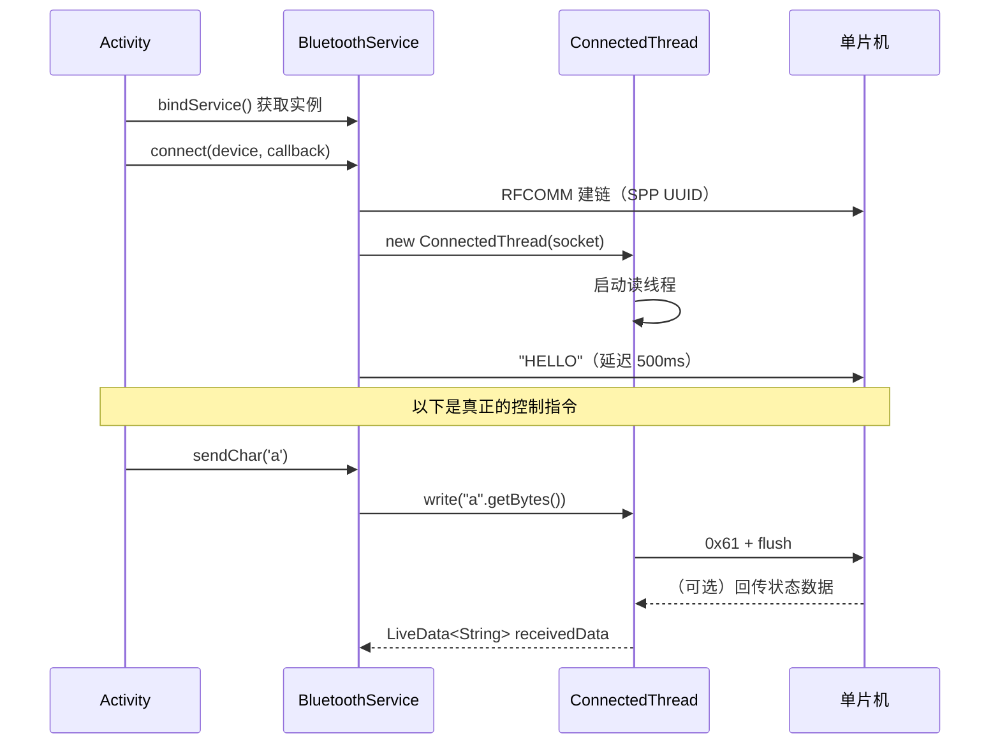

# 机器人 Agent 蓝牙控制协议

> 适用代码：`app/src/main/java/com/lhht/xiaozhi/services/BluetoothService.java`
> 说明：本文档描述的是**当前代码实际实现**的协议，不是理想设计。已知问题见第 6 节。

---

## 1. 传输层

| 项 | 值 |
|---|---|
| 蓝牙类型 | **经典蓝牙（Classic Bluetooth），不是 BLE** |
| 协议 | SPP（Serial Port Profile，串口透传） |
| UUID | `00001101-0000-1000-8000-00805F9B34FB` |
| 建链方式 | `device.createRfcommSocketToServiceRecord(SPP_UUID)` → `socket.connect()` |
| 角色 | 手机为**主叫方**（Client），单片机为**从机**（Server），需要先完成系统级配对 |

> 注意：不是 BLE 的 GATT 特征值读写。单片机必须实现 SPP 从机，而不是 BLE 外设。

---

## 2. 数据格式

**没有任何应用层协议封装。** 直接把 Java 字符串转成字节写进 socket：

```java
// BluetoothService.sendCommand()
connectedThread.write(command.getBytes());
```

```java
// ConnectedThread.write()
outputStream.write(data);
outputStream.flush();
```

所以特征是：

- 纯 **ASCII 文本**
- **单字符 = 一条指令**（多字符指令见第 3 节）
- ❌ 无帧头
- ❌ 无长度字段
- ❌ 无校验
- ❌ **无结束符（没有 `\n`）**

单片机收到的就是裸字节流，需要自己按"单字符"逐字节解析。

---

## 3. 指令表

### 3.1 单字符指令

| 指令 | ASCII | 含义 | 触发位置 |
|---|---|---|---|
| `a` | 0x61 | 前进 | ChatActivity：文本包含"前进"；导航方向为直行 |
| `b` | 0x62 | 后退 | ChatActivity：文本包含"后退" |
| `c` | 0x63 | 左转 | ChatActivity：文本包含"左转"；导航方向为左转 |
| `d` | 0x64 | 右转 | ChatActivity：文本包含"右转"；导航方向为右转 |
| `e` | 0x65 | 停止 | ChatActivity：文本包含"停止"；到达目的地（≤50 m） |
| `f` | 0x66 | 挥手（WAVE） | 服务端下发 `{"type":"action","action":"WAVE"}` |
| `n` | 0x6E | 无动作（NOACTION） | 服务端下发 `{"type":"action","action":"NOACTION"}` |

### 3.2 多字符指令

| 指令 | 示例 | 含义 |
|---|---|---|
| `HELLO` | `HELLO` | 连接成功后 500 ms 自动发送一次，用于测试链路 |
| `DISTANCE:<x.x>` | `DISTANCE:123.4` | 车辆距右侧车道线的距离（**像素**，非物理单位），保留 1 位小数 |

---

## 4. 一次完整的发送流程



### 4.1 手机端调用方式

```java
// 1. 绑定服务
bindService(new Intent(this, BluetoothService.class), connection, BIND_AUTO_CREATE);

// 2. 在 ServiceConnection 里拿到实例
BluetoothService btService = ((BluetoothService.LocalBinder) binder).getService();

// 3. 连接（device 来自 getBondedDevices()）
btService.connect(device, new BluetoothService.ConnectCallback() {
    @Override public void onConnected() { /* 可以发指令了 */ }
    @Override public void onError(String error) { }
});

// 4. 发送
btService.sendChar('a');       // 前进
btService.sendCommand("HELLO");
btService.sendDistance(123.4); // 实际发出 "DISTANCE:123.4"
```

### 4.2 单片机侧解析示例

单字符指令可以直接逐字节判断：

```c
void on_spp_rx(uint8_t b) {
    switch (b) {
        case 'a': motor_forward();  break;
        case 'b': motor_backward(); break;
        case 'c': turn_left();      break;
        case 'd': turn_right();     break;
        case 'e': motor_stop();     break;
        case 'f': servo_wave();     break;
        case 'n': /* 保持不动 */    break;
        default:
            // 'H'/'E'/'L'/'O' 或 'D'/'I'/'S'... 属于多字符指令，
            // 需要放进缓冲区，见下方说明
            break;
    }
}
```

---

## 5. 单片机实现要点

1. **实现 SPP 从机**，服务名任意，但 UUID 必须是 `00001101-0000-1000-8000-00805F9B34FB`。
2. **先配对再连接**：App 只列出 `getBondedDevices()` 的结果，未配对的设备不会出现在列表里。
3. **按字节而不是按字符串解析**：单字符指令本身就是完整的一帧，收到即可执行。
4. **多字符指令需要缓冲**：`HELLO` 和 `DISTANCE:...` 是连续到达的多个字节，且**没有结束符**。建议：
   - 用接收超时（如 50 ms 内无新字节）判定一帧结束；
   - 或者约定固定长度；
   - 或者**在协议里补一个 `\n`**（推荐，见第 6 节）。

---

## 6. 已知问题与改进建议

当前实现能跑，但有几个地方在换单片机或做稳定性优化时值得先改掉。

### 6.1 没有帧定界符

`DISTANCE:123.4` 后面没有 `\n`，如果两条距离数据连续到达，单片机无法切分。单字符指令不受影响。

**建议**：所有指令统一加 `\n` 结尾：

```java
connectedThread.write((command + "\n").getBytes(StandardCharsets.US_ASCII));
```

### 6.2 `getBytes()` 未指定字符集

```java
command.getBytes()   // 用的是平台默认字符集
```

当前指令全是 ASCII，绝大多数设备没问题；但换到非 UTF-8 默认字符集的系统上会出错。

**建议**：`command.getBytes(StandardCharsets.US_ASCII)`。

### 6.3 `isConnected()` 不可靠

```java
public boolean isConnected() {
    return socket != null && socket.isConnected();
}
```

Android 的 `BluetoothSocket.isConnected()` **在远端断开后不会变回 false**，只反映"本地曾经连接成功过"。所以小车断电后，App 仍可能认为已连接并继续"成功"发送。

**建议**：在 `ConnectedThread` 的 `read()` 返回 -1 或抛 `IOException` 时主动把状态置为断开。

### 6.4 语音页的 `order` 赋值是死代码

`VoiceCallActivity` 里有一组关键词匹配：

```java
else if (text != null && text.contains("向前走")) { order = 'a'; ... }
else if (text.contains("向后走")) { order = 'b'; ... }
// c / d / e / f / g / h / i ...
```

但 `order` 这个静态字段**赋值之后从来没有被发送出去** —— 该页面只有两处真正调用蓝牙：

```java
btService.sendChar('n');   // NOACTION
btService.sendChar('f');   // WAVE
```

也就是说"向前走/向后走/左转/右转/停下来"这些语音指令**目前不会驱动小车**。要生效，需要在关键词命中后直接调用 `btService.sendChar(order)`（并注意 `btServiceBound` 判断）。

### 6.5 发送在主线程

`ChatActivity` 里是在 UI 线程直接调 `sendChar()` 的，最终会在 UI 线程执行 `OutputStream.write()`。小数据量通常没事，但蓝牙链路异常阻塞时可能卡顿。

**建议**：把 `sendCommand()` 内部改为提交到 `executorService`。

---

## 7. 速查

```
传输：Bluetooth Classic / SPP / RFCOMM
UUID：00001101-0000-1000-8000-00805F9B34FB
格式：纯 ASCII 字节流，单字符即一帧，无换行无校验

a 前进    b 后退    c 左转    d 右转    e 停止
f 挥手    n 无动作
HELLO            连接测试
DISTANCE:123.4   车道线距离（像素）
```
