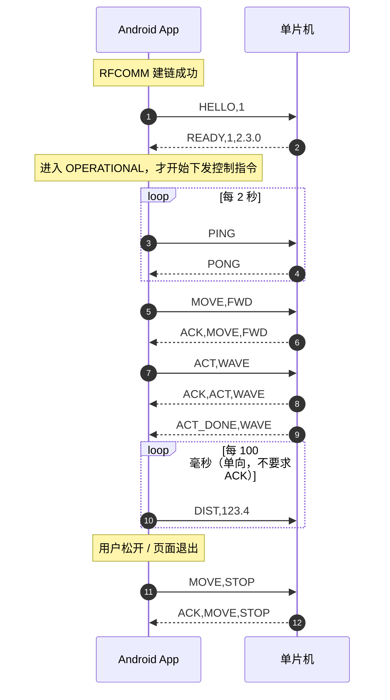
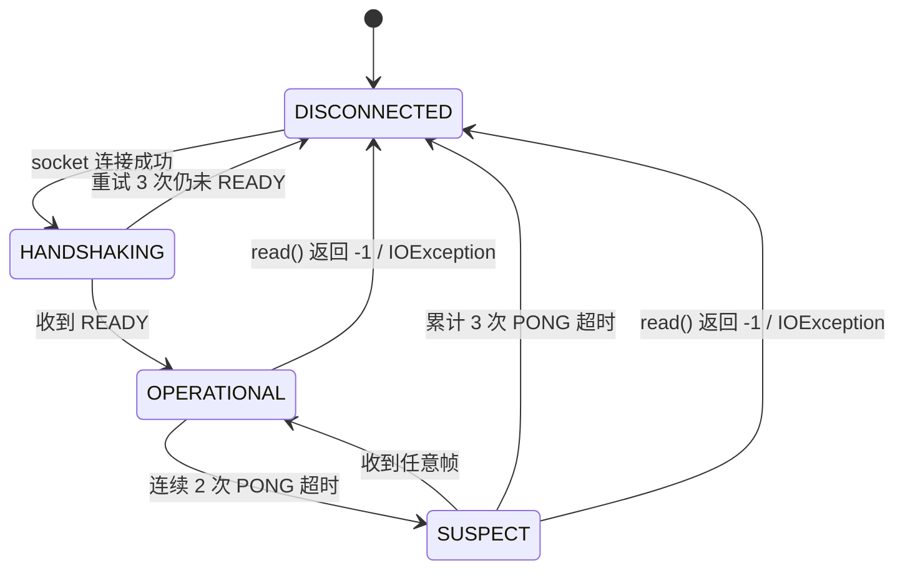

# 机器人控制协议 v2（XZ-Link/1）

> 取代 [BLUETOOTH_PROTOCOL.md](BLUETOOTH_PROTOCOL.md)（v1，裸单字符）。
> v1 描述的是**现状**，本文描述的是**目标规范**。两者可以并存一个过渡期，见第 9 节。
>
> 设计尺度：手机端 + 单片机端各自一个人、两天内能改完。刻意不引入
> 二进制编码、CRC 校验、分包重组 —— 理由见第 2.3 节。

---

## 1. 为什么 v1 不够用

v1 是 `"a"` / `"DISTANCE:123.4"` 这种裸字节流，能把车动起来，但有四个硬伤：

| # | 问题                 | 后果                                                                               |
| - | -------------------- | ---------------------------------------------------------------------------------- |
| 1 | 多字节指令没有结束符 | 连发两条 `DISTANCE:` 时单片机切不开，必然丢帧或串帧                              |
| 2 | 没有握手             | 手机显示"已连接"，单片机其实还没就绪 / 固件版本不对，无从判断                      |
| 3 | 没有心跳             | `BluetoothSocket.isConnected()` 远端断开后仍是 `true`，车断电了 App 还认为在线 |
| 4 | 单字符无语义         | 日志里全是 `a` `f`，排查问题要先查表                                           |

v2 只解决这四件事，别的都不加。

## 2. 设计原则

### 2.1 文本，不二进制

可读、可打印、串口助手直接手打调试是嵌入式联调最省时间的东西。

### 2.2 帧 = 一行

```
CMD,ARG1,ARG2\n
```

和 NMEA 0183、AT 指令、DJI Tello SDK 是同一个路子。**用换行符定帧**，
接收端只要一个 96 字节的缓冲区 + 一个 `\n` 判断就能解，不涉及内存分配。

### 2.3 刻意不加的三样东西

| 没加                | 原因                                                                                                 |
| ------------------- | ---------------------------------------------------------------------------------------------------- |
| **CRC 校验**  | SPP 跑在 L2CAP 上，底层已有 FCS 和重传，应用层误码率基本为 0。多加一层校验只增加单片机代码，没有收益 |
| **长度字段**  | 有 `\n` 做定界，长度天然可知。长度字段是二进制协议的必需品，文本协议里是冗余                       |
| **分包/重组** | 最长的帧 `ACT,POINT_RIGHT` 只有 15 字节，远小于 SPP 的 MTU（≥ 672 字节）。不可能被拆包            |

### 2.4 指令名与后端 action 码保持一致

服务端下发 `POINT_LEFT`，就直接发 `ACT,POINT_LEFT`。
**中间不做任何翻译表** —— 每多一层映射就多一处写错的机会。

---

## 3. 传输层

| 项       | 值                                                 |
| -------- | -------------------------------------------------- |
| 蓝牙类型 | 经典蓝牙（Classic），**不是 BLE**            |
| Profile  | SPP（Serial Port Profile / RFCOMM）                |
| UUID     | `00001101-0000-1000-8000-00805F9B34FB`           |
| 角色     | 手机 = 主叫方（Client）；单片机 = 从机（Server）   |
| 配对     | 系统级配对，App 只列出 `getBondedDevices()`      |
| 字符集   | **US-ASCII**（务必显式指定，不要用平台默认） |

---

## 4. 帧格式

### 4.1 文法

```
frame  :=  verb  ( ","  arg )*  LF
verb   :=  2~8 个大写字母
arg    :=  1~16 个字符，取自 [A-Za-z0-9_.-]
LF     :=  0x0A
CR     :=  0x0D      // 与 LF 同为帧结束符，二者任一即可（\n / \r / \r\n 都接受）
```

| 约束         | 值                                 |
| ------------ | ---------------------------------- |
| 单帧最大长度 | **96 字节**（含 `\n`）     |
| 发送端大小写 | verb 必须**全大写**          |
| 接收端大小写 | 建议大小写不敏感，容忍异常来源     |
| 超长帧       | 接收端丢弃整帧并复位缓冲区，不报错 |
| 首尾空白     | 接收端**必须**去掉整帧及每段首尾的空格/制表符 |

> **接收端的兜底：空闲判帧。**
> 规范要求发送方带结束符，但接收端还应该在 **200 ms 没有新字节**时，
> 把缓冲区里剩下的内容当成一帧处理（而不是丢弃）。思路同 Modbus RTU 的
> "3.5 字符静默间隔"。这样：① 不会配换行的串口助手也能联调；
> ② 某个结束符在传输中丢了，缓冲区也不会永久卡死。
> 发送端**仍然必须**带结束符 —— 否则连续两条指令可能被粘成一帧。
>
> **为什么要容忍首尾空白：** 中文输入法在英文后面常常自动补一个空格，
> 手工联调时很容易发出 `ACT,WAVE `。不做 trim 的话 `strcmp` 匹配不上，
> 得到一句"未知动作"，排查半天。**手机端解析单片机回包时同样要 trim。**

### 4.2 示例

```
HELLO,1               手机 → 单片机     握手
READY,1,2.3.0         单片机 → 手机     握手应答
MOVE,FWD              手机 → 单片机     前进
ACT,POINT_LEFT        手机 → 单片机     指向左
ACK,ACT,POINT_LEFT    单片机 → 手机     已执行
DIST,123.4            单片机 → 手机     车道线距离
```

---

## 5. 指令表

### 5.1 控制类（手机 → 单片机）

| 帧               | 说明                         | 幂等 |
| ---------------- | ---------------------------- | :--: |
| `HELLO,<ver>`  | 握手，`<ver>` 固定为 `1` |  ✅  |
| `MOVE,FWD`     | 前进                         |  ✅  |
| `MOVE,BCK`     | 后退                         |  ✅  |
| `MOVE,LEFT`    | 左转                         |  ✅  |
| `MOVE,RIGHT`   | 右转                         |  ✅  |
| `MOVE,STOP`    | 停止                         |  ✅  |
| `ACT,<action>` | 触发一次机械动作             |  ❌  |
| `PING`         | 心跳                         |  ✅  |
| `RESET`        | 紧急停止 + 舵机回中          |  ✅  |
| `DIST,<float>` | 车道线距离（像素，1 位小数），10 Hz，**不需要 ACK** |  ✅  |

> `DIST` 的方向是**手机 → 单片机**：车道线是手机端 OpenCV 算的，
> 单片机只负责照着执行。它以 10 Hz 发送，所以**不要求 ACK** ——
> 否则每分钟会多出 600 条回包，纯属浪费链路。

> **幂等**的含义：重复收到不改变结果。所以 `MOVE,*` 丢了不用重发，
> 而 `ACT,*` 是"触发一次"，重复收到会做两遍 —— 因此 `ACT` 不允许自动重发。

`<action>` 取值与服务端完全一致：

```
NONE  WAVE  CLAP  THINK  WELCOME  POINT_LEFT  POINT_RIGHT  SALUTE
```

### 5.2 状态类（单片机 → 手机）

| 帧                        | 说明                                | 必需 |
| ------------------------- | ----------------------------------- | :--: |
| `READY,<ver>,<fw>`      | 握手应答，`<fw>` 为固件版本字符串 |  ✅  |
| `ACK,<原始指令>`        | 命令已受理，原样回显                |  ✅  |
| `NAK,<原始指令>,<code>` | 命令被拒绝，见 5.3                  |  ✅  |
| `PONG`                  | 心跳应答                            |  ✅  |
| `ERR,<code>[,<detail>]` | 异步错误                            | 可选 |
| `ACT_DONE,<action>`     | 动作执行完毕                        | 可选 |

> `ACK` 里**不带序号**。因为它只用于判断"链路活着"和打日志，
> 不用于精确匹配请求。漏一个 ACK 不影响正确性 —— 心跳会兜底。

### 5.3 错误码

| code  | 含义                  |
| ----- | --------------------- |
| `1` | 未知命令              |
| `2` | 参数错误              |
| `3` | 未完成握手            |
| `4` | 设备忙                |
| `5` | 协议版本不支持        |
| `6` | 硬件故障（电机/舵机） |
| `7` | 不支持该能力（本机没有这个硬件，或动作尚未实现） |

> `7` 和 `6` 的区别：`6` 是"该有的硬件坏了"，`7` 是"这块板子根本没这个功能"。
> 单片机**不应该对做不到的事回 ACK** —— 那会让手机端误以为动作生效了。

---

## 6. 会话流程



### 6.1 状态机



> **只有 `OPERATIONAL` 状态才允许下发 `MOVE` / `ACT`。**
> `HANDSHAKING` 和 `SUSPECT` 状态下的控制指令直接丢弃并发日志。

---

## 7. 超时与重试

| 事件                                  | 阈值           | 处理                                          |
| ------------------------------------- | -------------- | --------------------------------------------- |
| 发出 `HELLO` 未收到 `READY`       | 1000 ms        | 重发，最多 **3 次**，仍失败判定连接失败 |
| `PING` 未收到 `PONG`              | 2 次连续       | 进入 `SUSPECT`，UI 提示"链路不稳定"         |
| 累计 PONG 超时                        | 3 次（约 6 s） | 判定断链，关闭 socket，提示重连               |
| **单片机超过 5 s 未收到任何帧** | 5000 ms        | **故障保护：立即停车；进行中的动作允许做完；空闲时舵机回中；握手状态保留** |

> ⚠️ **心跳超时 ≠ 链路断开。**
> 单片机超时后只做安全动作，**绝不能把 `handshaken` 清零**。
> 清零的话，客户端恢复发送后会收到 `NAK,<cmd>,3`，而客户端不会因此重新握手 ——
> 链路就永久死掉，只能人工重发 `HELLO` 才能恢复。
> 握手状态只在 **SPP 客户端真正消失**（`hasClient()` 下降沿）时才重置。


---

## 8. 失效保护（Safety）

这是 v1 完全没有、但对一台会动的车必须有的部分。

| 场景                                 | 行为                              |
| ------------------------------------ | --------------------------------- |
| 单片机上电 / 复位                    | 电机停止，舵机回中                |
| 手机停发超过 5 s                     | 立即停车；进行中的**有界动作允许做完**；空闲时回中；**握手保留** |
| SPP 客户端真正断开（`hasClient()` 变 false） | 同上，并**清零握手状态** |
| App 页面 `onDestroy` / 退出        | 先发 `MOVE,STOP`，再关闭 socket |
| 收到 `RESET`                       | 立即停车，清空动作队列            |
| `ACT` 执行过程中收到 `MOVE,STOP` | 立即中止动作，停车（这是**用户主动**要求停，不适用下面那条） |

**原则：任何异常路径的默认状态都是"停"，不是"保持最后的指令"。**

> **为什么断链时"动作允许做完"，但 `MOVE,STOP` 时"立刻中止"？**
> 两者性质不同：
> - **电机运动是无界的** —— 不停就永远开下去，必须立刻断。
> - **动作是有界的** —— 最长 6 秒，且每条动作的最后一帧本来就落在中位附近。
>   半路急停再瞬间回中，反而会产生一次突变的舵机跳位，更容易打坏齿轮。
> - **`MOVE,STOP` 是用户主动要求停** —— 这时候要的就是立刻停，不是优雅收尾。

---

## 9. 从 v1 迁移

过渡期单片机同时支持两套解析，靠**首字节大小写**区分，不会冲突：

| 首字节               | 判定          |
| -------------------- | ------------- |
| 小写 `a`~`n`     | v1 单字符指令 |
| 大写字母开头的完整帧 | v2            |

> ⚠️ **小写字母的判定不能依赖"缓冲区为空"这个前提。**
> 旧版 App 连接后会发一条**没有换行**的 `HELLO`；如果只在缓冲区为空时才走 v1 分支，
> 这条 `HELLO` 会把缓冲区永久占住，之后所有单字符指令都被当成帧的一部分吞掉，
> 结果是烧了新固件后旧 App 完全失灵。
> 正确做法：收到任何小写字母都立刻按 v1 处理，并丢弃可能残留的半帧。
> 参考实现的 `on_byte()` 就是这么写的。

| v1                 | v2             |
| ------------------ | -------------- |
| `a`              | `MOVE,FWD`   |
| `b`              | `MOVE,BCK`   |
| `c`              | `MOVE,LEFT`  |
| `d`              | `MOVE,RIGHT` |
| `e`              | `MOVE,STOP`  |
| `f`              | `ACT,WAVE`   |
| `n`              | `ACT,NONE`   |
| `HELLO`          | `HELLO,1`    |
| `DISTANCE:123.4` | `DIST,123.4` |

**迁移步骤**

1. 单片机先支持 v2 帧解析，同时保留 v1 分支（一小时的活）。
2. App 改为只发 v2，实测一轮。
3. 确认无误后删除单片机的 v1 分支。
4. 删除本文档第 9 节和 [BLUETOOTH_PROTOCOL.md](BLUETOOTH_PROTOCOL.md)。

---

## 10. 单片机侧实现参考

> ✅ **参考实现已经落地**：[hard-section/arduino-code/robot.ino](../hard-section/arduino-code/robot.ino)。
> 本节保留为**精简骨架**，用于理解结构；两者如果有出入，以 `.ino` 为准。

### 10.1 帧接收

```c
#define FRAME_MAX 96

static char   buf[FRAME_MAX];
static size_t len = 0;

void spp_rx(uint8_t b)
{
    /* '\r'、'\n'、"\r\n" 都算帧结束。
     * 只认 '\n' 会让默认用 CR 行尾的串口助手发来的指令全变成"半帧"。 */
    if (b == '\r' || b == '\n') {
        buf[len] = '\0';
        if (len > 0) handle_frame(buf);
        len = 0;
        return;
    }

    if (len < FRAME_MAX - 1) {
        buf[len++] = (char)b;
    } else {
        len = 0;                            /* 超长：整帧丢弃并复位 */
    }
}
```

### 10.2 帧分发

```c
static void handle_frame(char *f)
{
    if (!handshaken && strncmp(f, "HELLO,", 6) != 0) {
        send_frame("NAK,%s,3", f);          /* 未握手 */
        return;
    }

    char *argv[4];
    int   argc = split_csv(f, argv, 4);     /* 原地按 ',' 切分 */

    if (strcmp(argv[0], "HELLO") == 0) {
        if (atoi(argv[1]) != 1) { send_frame("NAK,%s,5", f); return; }
        handshaken = 1;
        send_frame("READY,1,%s", FW_VERSION);
    }
    else if (strcmp(argv[0], "MOVE") == 0) {
        move_cmd(argv[1]);                  /* FWD/BCK/LEFT/RIGHT/STOP */
        send_frame("ACK,%s", f);
    }
    else if (strcmp(argv[0], "ACT") == 0) {
        if (action_busy) { send_frame("NAK,%s,4", f); return; }
        action_start(argv[1]);              /* 后台执行，完成后发 ACT_DONE */
        send_frame("ACK,%s", f);
    }
    else if (strcmp(argv[0], "PING") == 0) {
        send_frame("PONG");
    }
    else if (strcmp(argv[0], "RESET") == 0) {
        motor_stop();
        action_abort();
        send_frame("ACK,%s", f);
    }
    else {
        send_frame("NAK,%s,1", f);          /* 未知命令 */
    }
}
```

### 10.3 故障保护定时器

```c
static uint32_t last_rx_ms;

void spp_rx_wrapper(uint8_t b) {
    last_rx_ms = millis();
    spp_rx(b);
}

void safety_tick(void) {                    /* 主循环里 100 ms 调一次 */
    if (handshaken && millis() - last_rx_ms > 5000) {
        handshaken = 0;
        motor_stop();
        action_abort();
        servo_center();
    }
}
```

---

## 11. App 端改造清单

对应现有代码，按改动量排序：

| # | 位置                                        | 改动                                                                                                                                                          |
| - | ------------------------------------------- | ------------------------------------------------------------------------------------------------------------------------------------------------------------- |
| 1 | `ConnectedThread.run()`                   | 现在的 `String data = new String(buffer, 0, bytes)` 直接把一次 `read()` 当成一条消息 —— **半帧/多帧都会出错**。改成与单片机同样的 `\n` 切帧缓冲 |
| 2 | `BluetoothService.sendCommand()`          | 追加 `"\n"`，字符集改 `StandardCharsets.US_ASCII`                                                                                                         |
| 3 | `BluetoothService`                        | 新增 `sendFrame(String... parts)`；`sendChar()` 逐步废弃                                                                                                  |
| 4 | `BluetoothService.connect()`              | 连上后先发 `HELLO,1`，收到 `READY` 才回调 `onConnected()`                                                                                               |
| 5 | `BluetoothService.isConnected()`          | 改为由 `PONG` 驱动的状态机，不再依赖 `socket.isConnected()`                                                                                               |
| 6 | `VoiceCallActivity.handleActionMessage()` | 改为 `sendFrame("ACT", action)`，一次覆盖全部 8 个动作码                                                                                                    |
| 7 | `VoiceCallActivity` 关键词                | 修掉 `order` 死代码，直接 `sendFrame("MOVE", dir)`                                                                                                        |
| 8 | `ChatActivity`                            | 导航/关键词由 `sendChar('a')` 改为 `sendFrame("MOVE","FWD")`                                                                                              |
| 9 | 各页面 `onDestroy()`                      | 退出前发 `MOVE,STOP`                                                                                                                                        |

---

## 12. 速查卡

```
传输：Bluetooth Classic / SPP / RFCOMM
UUID：00001101-0000-1000-8000-00805F9B34FB
编码：US-ASCII      定帧：'\n'      最大：96 字节

握手：HELLO,1  →  READY,1,<fw>
心跳：PING     →  PONG          （2 s 一次）
运动：MOVE,FWD|BCK|LEFT|RIGHT|STOP
动作：ACT,NONE|WAVE|CLAP|THINK|WELCOME|POINT_LEFT|POINT_RIGHT|SALUTE
遥测：DIST,123.4   手机→单片机  （10 Hz，不回 ACK）
应答：ACK,<原样回显>  /  NAK,<原样回显>,<code>
保护：5 s 无任何帧 → 停车
```
