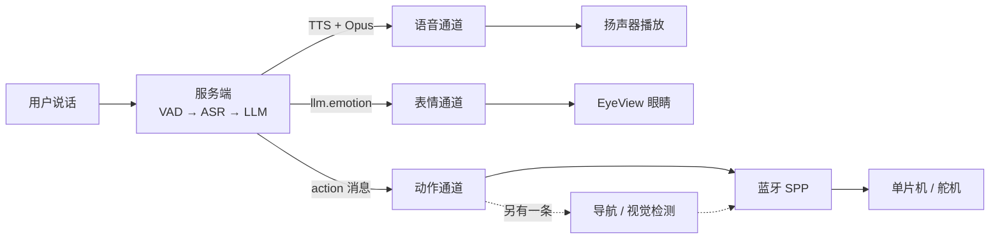
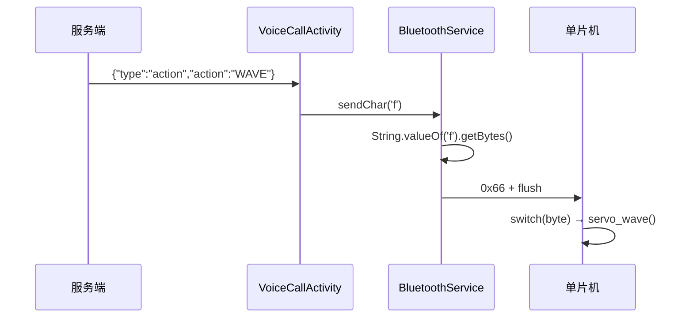
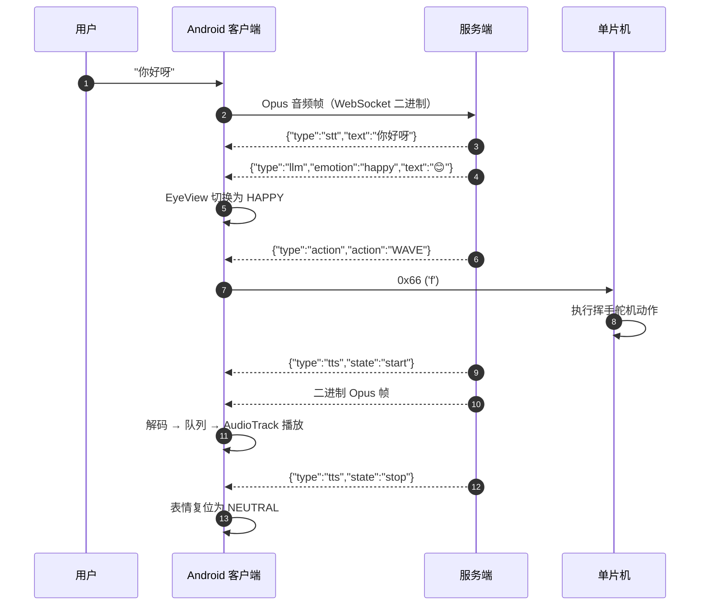

# 机器人 Agent 控制链路总览

> 本文把**服务端输出契约**、**客户端消息分发**、**蓝牙/单片机执行**串成一条完整链路，
> 并标出当前实现里所有"断掉"的地方。
>
> 分册文档：
> - 服务端语音/动作输出：[VOICE_ACTION_OUTPUT.md](VOICE_ACTION_OUTPUT.md)
> - 蓝牙字节协议：[BLUETOOTH_PROTOCOL.md](BLUETOOTH_PROTOCOL.md)

---

## 1. 一句话概括



**语音和动作是两条独立的 WebSocket 通道**：服务端把 LLM 输出拆成"要朗读的话"和"要做的动作"分别下发，客户端收到动作应立即执行，不需要等语音播完。

---

## 2. 服务端下发的四类消息

| 消息 | 触发时机 | 示例 | 客户端用途 |
|---|---|---|---|
| `stt` | ASR 出结果 | `{"type":"stt","text":"你好呀"}` | 显示识别文本 |
| `tts` | 合成语音 | `{"type":"tts","state":"start\|sentence_start\|stop",...}` + 二进制 Opus | 播放 |
| `action` | 解析出动作码 | `{"type":"action","action":"WAVE"}` | 驱动舵机/动画 |
| `llm` | 回复中检测到 emoji | `{"type":"llm","text":"😊","emotion":"happy"}` | 驱动表情 |

> `tts` 的结束状态是 **`stop`**（不是 `end`）。这一点很关键 —— 客户端曾因只接 `end` 导致表情永远不复位。

> 当前服务端一次回复最多下发 **1 条** `action` 消息（多动作尚未上线）；
> 即使没有动作也会下发 `{"action":"NOACTION"}`，而不是完全不发。
>
> 动作执行模型已确定为**方案 A：收到即执行**。服务端解析出动作就立即下发，
> **两端都不存在"动作队列"这个对象** —— 客户端收到就执行即可，不需要排队，也没有队列要清空。

### 2.1 动作码表（服务端定义）

| 代码 | 含义 |
|---|---|
| `NOACTION` | 无动作 |
| `WAVE` | 挥手打招呼 |
| `CLAP` | 拍手鼓掌 |
| `THINK` | 思考（手托下巴） |
| `WELCOME` | 双臂张开欢迎 |
| `POINT_LEFT` | 指向左 |
| `POINT_RIGHT` | 指向右 |
| `SALUTE` | 敬礼 |

---

## 3. 客户端如何接收

入口只有一个：[VoiceCallActivity.onMessage()](app/src/main/java/com/lhht/xiaozhi/activities/VoiceCallActivity.java)

```java
switch (type) {
    case "stt":    ... 显示识别文本
    case "tts":    handleTTSMessage(jsonMessage)
    case "mcp":    handleMcpMessage(jsonMessage)      // 视觉工具调用
    case "action": handleActionMessage(jsonMessage)   // ← 动作通道
    default:       Log.d("VoiceCall", "未处理的消息类型: " + type)
}
```

⚠️ **只有语音通话页处理 `action`**。`ChatActivity`、`MainActivity`、`Voice` 都没有 `handleActionMessage` —— 在那些页面上，服务端下发的动作会被直接丢弃。

---

## 4. 动作通道：服务端动作 → 蓝牙单片机

### 4.1 当前实际接通的部分

[handleActionMessage()](app/src/main/java/com/lhht/xiaozhi/activities/VoiceCallActivity.java) 只写了两个分支：

```java
switch (action) {
    case "NOACTION": btService.sendChar('n'); break;
    case "WAVE":     btService.sendChar('f'); break;
}
```

### 4.2 ⚠️ 后端 8 个动作码，客户端只接 2 个

| 后端 `action` | 含义 | 客户端处理 | 实际发给单片机 |
|---|---|---|---|
| `NOACTION` | 无动作 | ✅ | `n` |
| `WAVE` | 挥手 | ✅ | `f` |
| `CLAP` | 鼓掌 | ❌ **忽略** | 无 |
| `THINK` | 思考 | ❌ **忽略** | 无 |
| `WELCOME` | 欢迎 | ❌ **忽略** | 无 |
| `POINT_LEFT` | 指向左 | ❌ **忽略** | 无 |
| `POINT_RIGHT` | 指向右 | ❌ **忽略** | 无 |
| `SALUTE` | 敬礼 | ❌ **忽略** | 无 |

服务端即使正确解析出 `CLAP`，客户端也会静默丢掉 —— **既没有日志也没有提示**。

> 补全方法见第 8 节。

### 4.3 蓝牙字节协议摘要



| 项 | 值 |
|---|---|
| 类型 | 经典蓝牙 SPP（**不是 BLE**） |
| UUID | `00001101-0000-1000-8000-00805F9B34FB` |
| 格式 | 纯 ASCII 字节流，**单字符即一帧**，无帧头/长度/校验/换行 |
| 连接后 | 自动发送 `HELLO` |
| 距离上报 | `DISTANCE:123.4`（像素，1 位小数） |

完整字节表与单片机侧解析示例见 [BLUETOOTH_PROTOCOL.md](BLUETOOTH_PROTOCOL.md)。

---

## 5. 其他控制入口

### 5.1 文字聊天页：文本关键词 → 蓝牙

[ChatActivity](app/src/main/java/com/lhht/xiaozhi/activities/ChatActivity.java) 不解析 `action` 消息，而是**自己匹配回复文本里的关键词**：

| 关键词 | 发出的字节 |
|---|---|
| 前进 | `a` |
| 后退 | `b` |
| 左转 | `c` |
| 右转 | `d` |
| 停止 | `e` |

### 5.2 导航驱动

[ChatActivity](app/src/main/java/com/lhht/xiaozhi/activities/ChatActivity.java) 会持续读取导航方向，自动下发：

| 导航方向 | 字节 |
|---|---|
| 直行 / 前进 | `a` |
| 左转 / 左拐 | `c` |
| 右转 / 右拐 | `d` |
| 距终点 ≤ 50 m | `e`（停车） |

同时把右侧车道线距离通过 `DISTANCE:x.x` 发给单片机。

### 5.3 语音页关键词：**当前是断的**

[VoiceCallActivity](app/src/main/java/com/lhht/xiaozhi/activities/VoiceCallActivity.java) 里有一大段关键词匹配：

```java
if (text.contains("向前走"))      order = 'a';
else if (text.contains("向后走")) order = 'b';
else if (text.contains("向左转")) order = 'c';
else if (text.contains("向右转")) order = 'd';
else if (text.contains("停下来")) order = 'e';
```

**但 `order` 这个静态字段赋值后再也没有被读取或发送。** 该页面真正调用蓝牙的只有 `handleActionMessage()` 里的 `'n'` 和 `'f'`。

也就是说：**对着手机说"向前走"，小车不会动。** 修法见第 8.3 节。

### 5.4 打断

用户轻触屏幕时，客户端发送：

```json
{"type": "abort"}
```

并立刻清空本地音频缓冲。

> ⚠️ 旧实现发的是 `{"type":"interrupt"}`，服务端不识别这个类型，会当未知消息忽略 ——
> 表现为"提示已打断，但 AI 还在继续说话"。已修正。

### 5.5 NB-IoT：目前只能收，不能发

[NBIOTActivity](app/src/main/java/com/lhht/xiaozhi/activities/NBIOTActivity.java) 通过 MQTT 工作：

| 项 | 值 |
|---|---|
| 协议 | MQTT（Eclipse Paho） |
| 订阅主题 | `xiaozhi` |
| 发布主题 | `nbiot`（**声明了但从未 publish**） |

当前只把收到的消息显示在界面上，**没有任何下发控制指令的代码**。所以它是监控通道，不是控制通道。

---

## 6. 反馈通道

| 通道 | 数据来源 | 呈现 |
|---|---|---|
| 表情 | `{"type":"llm","emotion":"happy"}` | `EyeView` 21 种情绪形态 |
| 语音波形 | 解码后的 PCM | `WaveformView`（50ms 节流、100 点峰值降采样） |
| 识别文本 | `stt.text` | 底部文本 |
| 回复文本 | `tts.sentence_start.text` | AI 消息区 |
| 距离/状态 | MQTT `xiaozhi` 主题 | NB-IoT 页文本 |

表情的枚举名与服务端取值**一一对应**（`neutral` / `happy` / `laughing` … 共 21 个），直接按名称映射，认不出来回落 `NEUTRAL`。

---

## 7. 端到端一次完整往返



---

## 8. 新增 / 修复一个动作的完整清单

### 8.1 服务端（三处，缺一不可）

1. `core/utils/textUtils.py` 的 `ACTION_DESCRIPTIONS` —— 动作码白名单
2. `data/.config.yaml` 的 `prompt:` 动作清单 —— 让模型知道有这个动作
3. 设备端实现对应的舵机/动画

详见 [VOICE_ACTION_OUTPUT.md](VOICE_ACTION_OUTPUT.md#6-新增一个动作要改哪里)。

### 8.2 客户端：补全未接的动作码

在 `handleActionMessage()` 里把剩余 6 个补上，并约定对应的蓝牙字节：

```java
switch (action) {
    case "NOACTION":    btService.sendChar('n'); break;
    case "WAVE":        btService.sendChar('f'); break;
    case "CLAP":        btService.sendChar('h'); break;   // 与现有"鼓掌"约定一致
    case "THINK":       btService.sendChar('i'); break;   // 与现有"功夫"约定一致
    case "WELCOME":     btService.sendChar('w'); break;   // 需单片机新增
    case "POINT_LEFT":  btService.sendChar('l'); break;   // 需单片机新增
    case "POINT_RIGHT": btService.sendChar('r'); break;   // 需单片机新增
    case "SALUTE":      btService.sendChar('s'); break;   // 需单片机新增
    default:
        Log.w("Action", "未知动作码: " + action);          // 至少留一条日志
}
```

> ⚠️ 新增字节（`w/l/r/s`）必须和单片机固件同步，否则单片机收到会当成未知字符忽略。

### 8.3 客户端：修通语音页关键词

在关键词命中后直接发送，而不是只给静态字段赋值：

```java
if (text.contains("向前走")) {
    order = 'a';
    if (btServiceBound && btService != null) btService.sendChar(order);
}
```

或者更干净：把 `order` 从 `public static` 改成局部变量，每个分支直接 `sendChar(...)`。

---

## 9. 当前断点汇总

按修复价值排序：

| # | 问题 | 影响 | 位置 |
|---|---|---|---|
| 1 | 后端 8 个动作码，客户端只处理 2 个 | 鼓掌/思考/欢迎/指向/敬礼全部无效 | `handleActionMessage()` |
| 2 | 语音页关键词只赋值不发送 | "向前走/后退/转/停"全部无效 | `VoiceCallActivity` |
| 3 | 只有语音页处理 `action` | 在聊天页/首页时不执行动作 | `ChatActivity` 等 |
| 4 | NB-IoT 只订阅不发布 | 广域远程控制实际不可用 | `NBIOTActivity` |
| 5 | 蓝牙无帧定界符 | 连续 `DISTANCE:` 无法切分 | `BluetoothService` |
| 6 | `BluetoothSocket.isConnected()` 不可靠 | 小车断电后仍显示已连接 | `BluetoothService` |

前三条会让"功能看起来没做"，后三条属于稳定性问题。

---

## 10. 快速验证清单

1. **语音 + 表情**：说一句话，服务端应依次下发 `stt` → `llm(emotion)` → `tts`；眼睛跟随情绪变化，`stop` 后复位。
2. **动作**：让模型做一个 `WAVE`，logcat 应出现 `btService.sendChar('f')`，单片机执行挥手。
3. **补全验证**：服务端下发 `CLAP`，当前客户端**不会**有任何反应 —— 这是第 9 节第 1 条的现场复现。
4. **蓝牙链路**：见 [BLUETOOTH_PROTOCOL.md](BLUETOOTH_PROTOCOL.md) 第 7 节速查表。
